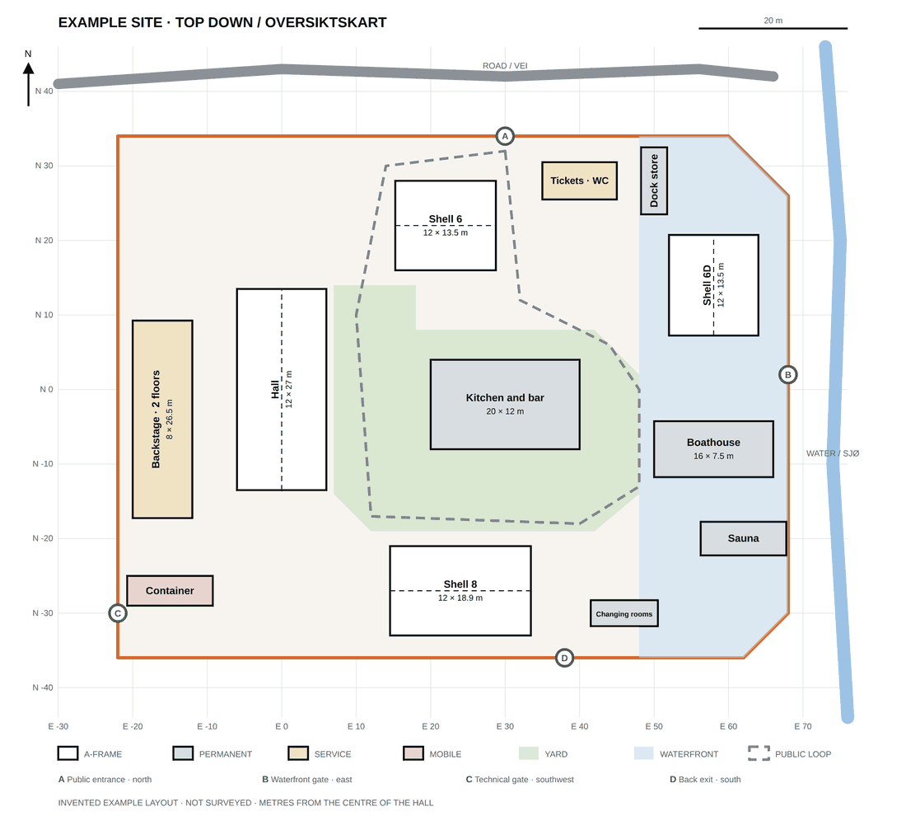
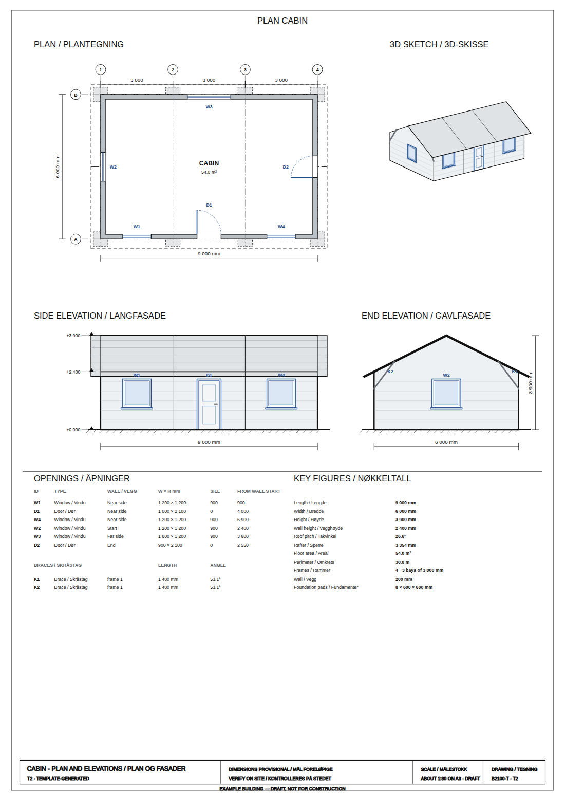
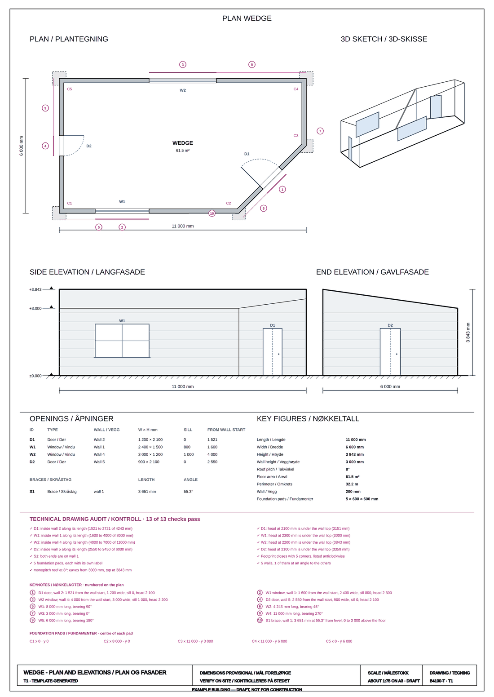
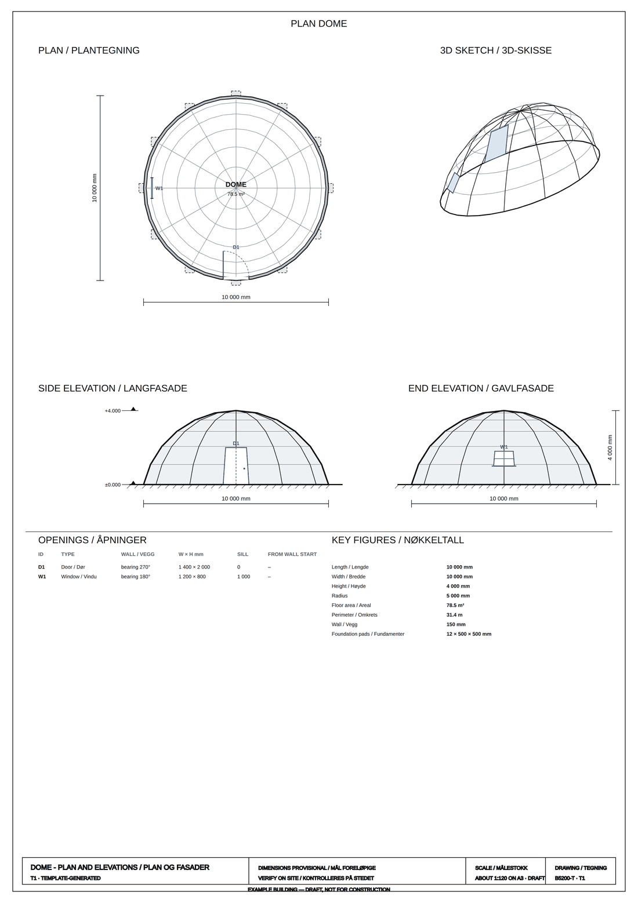

# Fiskehjell A-frame drawings

A data-driven sheet generator for A-frame buildings in the style of the
Norwegian *fiskehjell*, the timber rack used to dry stockfish. One building
specification controls the top-down, A-frame, side and 3D views, so dimensions,
stations, doors, anchors and bracing cannot silently drift between views.

The four buildings and the site layout in this repository are **examples**.
Every dimension is provisional. Nothing here is an engineering or contractor
drawing, and nothing may be built from it without independent verification.

| Hall | Shell 8 | Example site |
| --- | --- | --- |
|  |  |  |

| Cabin | Wedge, audit mode on | Dome |
| --- | --- | --- |
|  |  |  |

## Example buildings

| Id | Name | What it shows |
| --- | --- | --- |
| `hall` | Hall | 12 × 27 m, 13 frames, eight main anchors, an open four-frame extension and a clear pedestrian passage |
| `shell6` | Shell 6 | Six-frame closed shell, four corner anchors, one full-span wire cross on each long wall |
| `shell6d` | Shell 6D | The six-frame shell with two opposed internal doors and one gable-end exit |
| `shell8` | Shell 8 | Eight-frame closed shell, six anchors, one full-height wire cross on each long wall |

## Other building forms

The same geometry draws buildings that are not A-frames. Each is one
specification in `src/buildings/`, drawn by `src/render-building.mjs` as a plan,
a side elevation and an end elevation at one shared scale, a 3D sketch, an
openings schedule and key figures.

| Id | Form | What it shows |
| --- | --- | --- |
| `cabin` | Box, gable roof | Walls with thickness, doors with swings, windows, roof overhang, knee braces |
| `shed` | Box, mono-pitch roof | A lean-to roof, a wire cross and a strut: sloped members with their angles |
| `wedge` | Diagonal footprint, mono-pitch roof | A plan that is not a rectangle, with a door on the angled wall |
| `lodge` | Footprint with a cut corner, hip roof | A roof plane rising inward from every wall |
| `taper` | Tapering footprint, gable roof | Eaves that climb as the plan narrows |
| `rack` | A-frame | The fiskehjell section itself, drawn by this sheet straight from the geometry |
| `arch-hall` | Arch, semicircle | A curved rib extruded along the building |
| `segmental-hall` | Arch, segmental | A low, wide rib that rises less than half its span |
| `pointed-hall` | Arch, pointed | A rib of two arcs meeting at a point |
| `lavvo` | Round, cone | A round footprint with an open top |
| `dome` | Round, dome | A round footprint under part of a sphere |

A specification has a `form`, `openings`, optional `braces` and a foundation pad
size:

- `form.kind` is `aframe`, `box` (with `roof.kind` `flat`, `monopitch` or `gable`), `arch`
  (`semicircle`, `segmental` or `pointed`), `footprint` (corners listed
  anticlockwise, with a wall height) or `round` (`cone` or `dome`).
- A footprint takes a `roof`: `monopitch` (with a `rise` direction), `gable`
  (with a `ridge` direction) or `hip`, each at a `pitchDeg`. The roof is the
  lowest of its tilted planes, so ridges, hips and sloping wall tops follow from
  the planes. Gable and hip roofs need a footprint without notches.
- An opening names its wall and its centre as a ratio along that wall, seen from
  outside. Walls are `near`, `far`, `start` and `end` on a box or arch, a number
  on a footprint, and a `bearingDeg` on a round building.
- A brace runs between two points on a wall, or in one frame with `station`.

### Technical drawing audit mode

Every sheet carries an audit layer that is off by default. Tick **Technical
drawing audit mode** above the sheet in a browser, or open `cabin.html#audit`.
It adds, in one colour over the same drawing: the coordinate of every frame,
the label of every foundation pad, and numbered keynotes on the plan for each
opening, each wall of a diagonal footprint and each brace. Below the drawing it
lists the checks with a tick or a cross, the text of every keynote, and the
position of every pad. Keynote markers slide along their wall until clear, so
they never sit on top of each other. The checks cover openings that run past
a wall, stand taller than it or overlap each other, braces that leave their
wall, bays that do not add up, and the roof pitch or arch radius.

`npm run build` refuses a building that fails a check. The exporter writes the
plain sheet as page 1 and the audited sheet as page 2 of each building's PDF.

To add a building, copy the nearest example in `src/buildings/`, add it to
`src/buildings/index.mjs` and to `FORMS` in `scripts/export.py`, and add a test.

## Generate and verify

Requirements: Node 22 or newer for the drawings; Python 3 with `reportlab`,
`pypdf` and `pillow`, plus a browser, for PNG and PDF export. The browser is
Chrome, Chromium or Edge, or Firefox together with `geckodriver`.

```sh
npm test
npm run build
python scripts/export.py
```

`npm run build` writes one drawing sheet and one checkpoint sheet per A-frame
building and one sheet per other building to `dist/`, and the machine-readable data to `output/data/`. Open
`dist/hall.html` in a browser, or print it to an A3 PDF.

`python scripts/export.py` writes:

- one 3000 × 4230 PNG per building to `output/png/`;
- one two-page A3 PDF per building to `output/pdf/<building>.pdf`: the
  coordinated drawing, then a checkpoint page with dimensions, labels and
  foundation coordinates;
- `output/pdf/a-frame-buildings.pdf`, the combined set: the four A-frame
  drawings, the site map, the register of every building, four checkpoint
  pages, then each other building with its audited sheet;
- `output/pdf/a-frame-buildings-no-overview.pdf`, the same set without the site
  map.

The exporter finds a browser on the `PATH` or in the usual install locations,
and prefers Chrome, Chromium or Edge. `--browser firefox` or `--browser chrome`
chooses one; `CHROME_PATH` points at a Chrome-family executable explicitly.
Both give the same page counts, page sizes and image sizes. Text edges differ
slightly between the two, so images are not identical pixel for pixel.
Generated files are not committed.

For a quicker iteration on one checkpoint page, after a full export:

```sh
npm run build
python scripts/export.py --building hall --checkpoint-only
```

Omit `--checkpoint-only` to regenerate both pages and the PNG for one building.
Repeat `--building` to select several.

The lower part of each checkpoint page shows three simplified top-down
construction states from the same footprint: joists with chicken wire, blocking
with insulation, and the finished floor layer. These states live in
`checkpoint.topDownLayers` and can be overridden per building.

## Create another A-frame building

1. Copy `src/specs/hall.mjs` (or `shell6.mjs` for a plain closed shell) to a
   new building name.
2. Change dimensions, frame count, doors, anchors and bracing in that spec.
3. Import the new spec in `scripts/build.mjs`, and add its id to `BUILDINGS`
   in `scripts/export.py`.
4. Add a test covering the new building's authoritative dimensions and labels.

The renderer expects `stations === bays + 1`. Custom non-uniform station
locations can be supplied as normalized `stationRatios` from `0` to `1`.

## Geometry core

`src/geometry.mjs` describes a building as a cross-section **profile** extruded
along its length through numbered **stations**:

- `profiles.aframe({ widthMm, heightMm })` is the section: named corners, the
  members of one frame, and the outline the end view draws.
- `extrude(profile, runs, { lengthMm })` is the solid: a frame at every station
  and a rail along every corner. Separate runs leave a gap, such as the Hall's
  open passage.
- `obliqueView(...)` and `projectSolid(...)` give the 3D sketch; `elevation(...)`
  fits the section into the end view.

It also holds box and arch sections, `prismSolid` for a footprint that is not a
rectangle and `revolvedSolid` for a round one. The other building forms are
drawn entirely from these. On the A-frame sheets the 3D sketch and the end view
are drawn from the core; their plan and side views still work from the
dimensions and stations directly.

## Specification ownership

| Section | Controls |
| --- | --- |
| `dimensions` | Closed length, width, height and extension length |
| `structure` | Stations, bays, ridge, cross-beam, extension frames and the clear interface passage |
| `anchors` | Closed anchor stations, B labels and L-extension labels |
| `doors` | End pairs, middle door, canopy, leaf split and outward swing |
| `bracing` | Near/far steel-wire convention and braced side-view zones |
| `shellGraph` | Named 3D structural nodes, node-to-node edges, open interface gap and outer X/Y/Z extents |
| `notes` | Status and verification statements printed on the sheet |

The 3D structure is topology-driven: every line references two named nodes.
Move a node once to update every connected edge. `axisExtents` owns the outer
X, Y and Z datums, and `clearPassage.between` records the deliberate missing
base connection at the shell/extension pedestrian opening.

Doors can be added, removed or moved with `sideDoor.enabled`,
`sideDoor.stationRatio` and `endGableCenters`. Wire elements are individually
addressable in `bracing.elements`; each has an id, a wall, two normalized
endpoints and an optional curve offset.

## Example site model

`src/site-model.mjs` holds an **invented** site: it copies no real place. It is
laid out to show how the pieces are meant to work together:

- **North:** the road, the public entrance, with tickets and toilets beside it.
- **West:** the Hall, with a backstage block and a delivery gate behind it, so
  crew and goods never cross the public yard.
- **Middle:** an open yard, with the kitchen and bar serving every room.
- **South:** the long Shell 8 across the yard from the entrance, with a back exit.
- **East:** the waterfront, with the boathouse, sauna, changing rooms and a quiet
  shell.

A structure is a rectangle unless it gives `round: true` (a circle whose
diameter is its width) or `outline` (its own corners, in metres from its centre;
any simple shape, such as an L). The example site has one of each: the lavvo and the wedge.

The Hall is fixed at local `E=0, N=0`; every other structure, perimeter vertex,
zone and gate is in metres from that reference, rounded to half a metre.
Building sheets keep their local `X=length, Y=width, Z=height` axes, while the
site uses `E/N/Z`.

`npm run build` validates the model, writes `output/data/site-model.json` (with
derived footprint corners, extents and perimeter length) and draws
`dist/site-map.html` from it with `src/render-site-map.mjs`. Move a structure in
the model and the map follows; a structure outside the perimeter is refused.

Opened in a browser, `dist/site-map.html` is also a layout editor. Drag a
structure or a perimeter corner (positions snap to half a metre), rotate the
selected structure with the buttons or the `[` and `]` keys, nudge it with the
arrow keys, and add or remove structures: containers, service units, round
ones and ones with an angled corner. A structure that
overlaps another or leaves the perimeter is outlined in red and named in the
status line. **Copy layout** gives the `structures` and `perimeter` text to
paste into `src/site-model.mjs`; nothing is saved until you do. Zones, gates,
road and water are not editable in the page. The exporter opens
`site-map.html#static`, which is the drawing without the editor.

See [docs/site-coordinate-system.md](docs/site-coordinate-system.md) for the
coordinate contract, validation rules and known limits.

## Licence

MIT. See [LICENSE](LICENSE).
